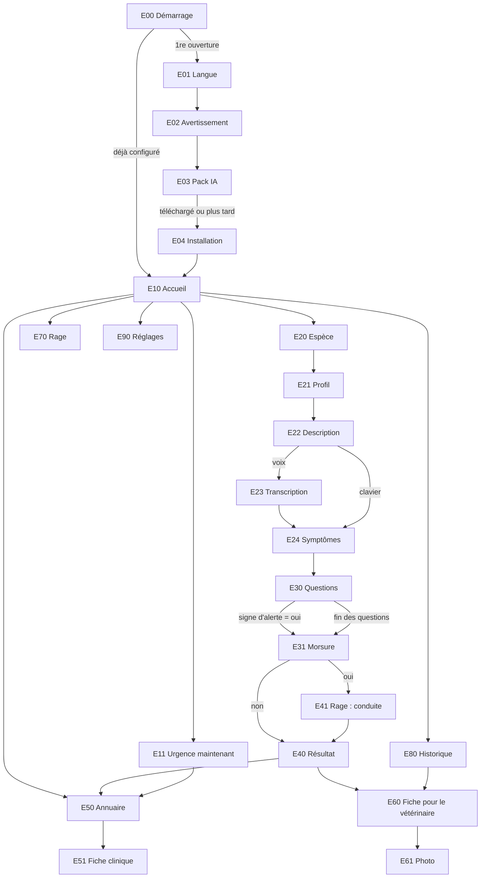
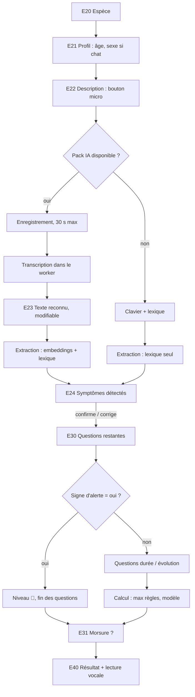
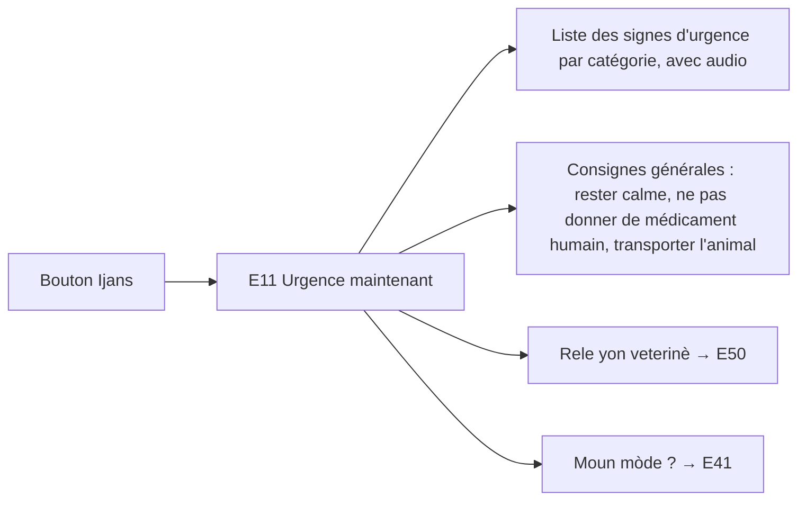
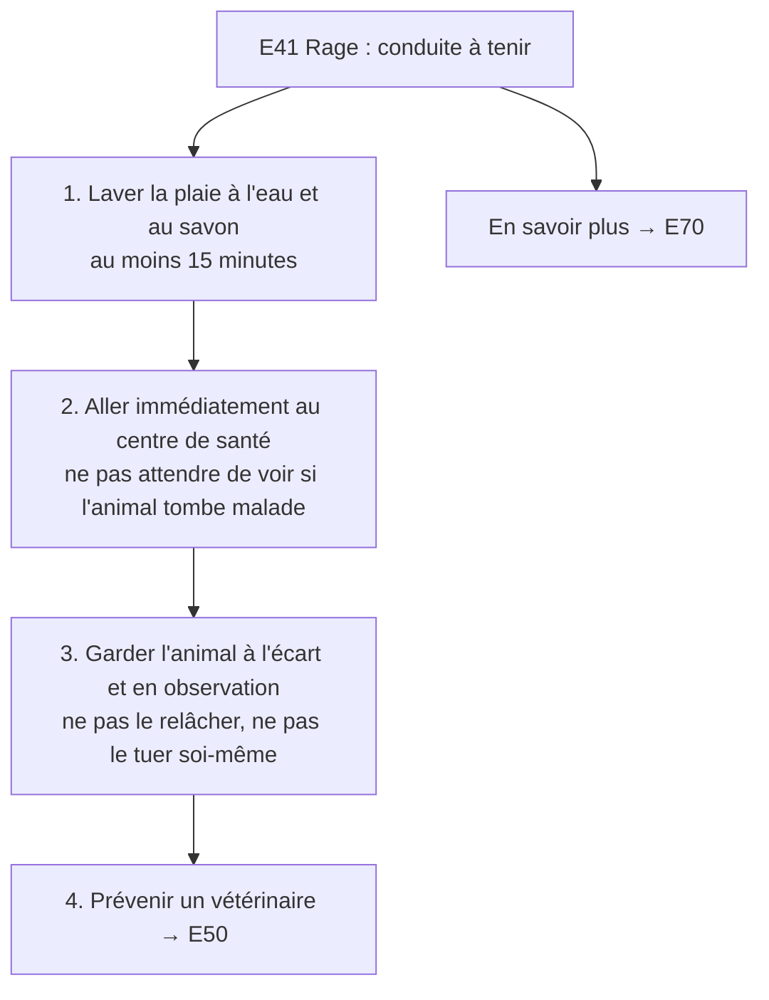
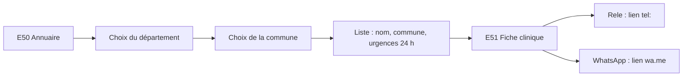
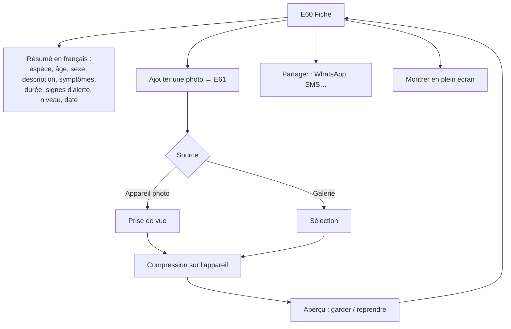
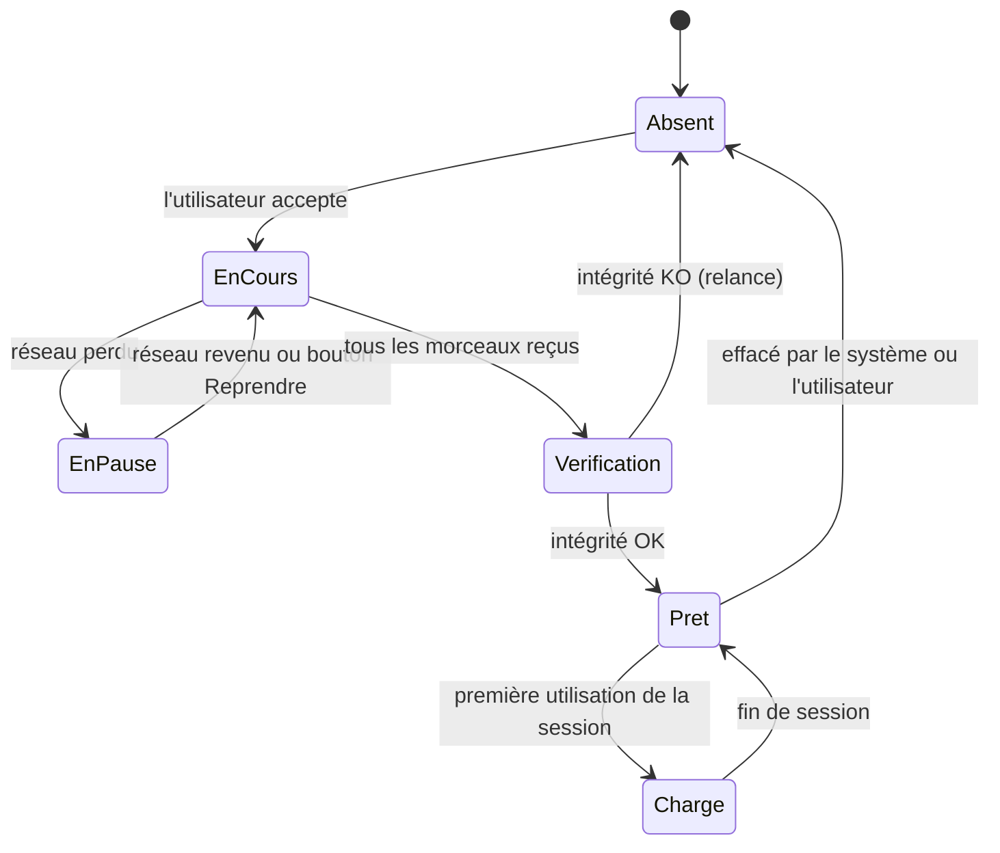
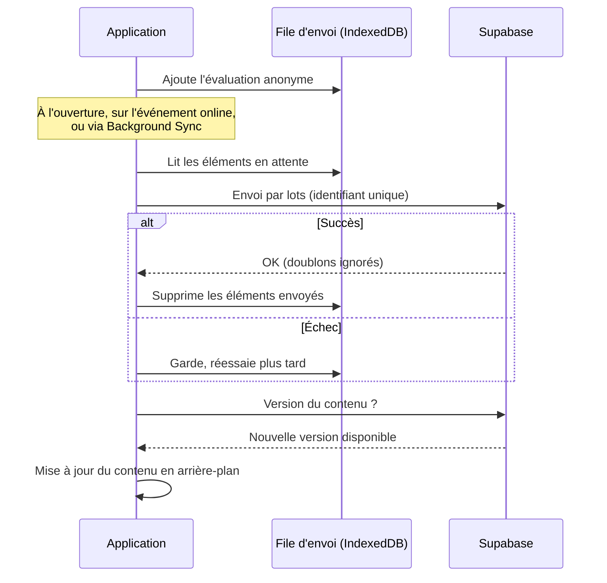

# Sanimo — App flow

| | |
|---|---|
| Version | 0.1 (brouillon) |
| Date | 31 octobre 2026 |
| Basé sur | [PRD v0.2](01-PRD.md) · [TRD v0.1](02-TRD.md) |
| Portée | Écrans, navigation, parcours et états. Le design visuel est traité dans le document 04 (reporté) |

Les diagrammes utilisent la syntaxe **Mermaid**. Ils s'affichent dans GitHub, VS Code (avec l'extension Mermaid) et la plupart des éditeurs Markdown.

Les textes sont donnés en créole, avec la traduction française entre parenthèses quand c'est utile. Les formulations finales seront relues par un locuteur natif.

---

## 1. Inventaire des écrans

| ID | Écran | Rôle | Exigences PRD |
|---|---|---|---|
| E00 | Démarrage | Charge l'application, vérifie le contenu et le pack IA | F-80 |
| E01 | Choix de la langue | Kreyòl / Français | F-01 |
| E02 | Avertissement | « Sanimo pa ranplase yon veterinè » (Sanimo ne remplace pas un vétérinaire), lu à voix haute | F-02 |
| E03 | Pack IA | Taille, conseil Wi-Fi, téléchargement, progression | F-04 |
| E04 | Installation | Bouton Android ou instructions iOS | F-03 |
| E10 | Accueil | Nouvelle évaluation, Urgence, Vétérinaires, Rage, Historique | — |
| E11 | Urgence maintenant | Signes d'urgence, consignes générales, accès aux vétérinaires | F-05 |
| E20 | Espèce | Chien / Chat | F-10 |
| E21 | Profil de l'animal | Âge (petit / adulte / âgé), sexe pour le chat | F-10 |
| E22 | Description | Micro (par défaut) ou clavier | F-11, F-12 |
| E23 | Transcription | Texte reconnu, modifiable | F-11 |
| E24 | Symptômes détectés | Liste proposée, à confirmer ou corriger | F-13 |
| E30 | Question | Une question fermée par écran, lue à voix haute | F-20 à F-24 |
| E31 | Morsure | « L'animal a-t-il mordu ou griffé quelqu'un ? » | F-70 |
| E40 | Résultat | Niveau, raison, consignes, lecture vocale | F-30 à F-35 |
| E41 | Rage : conduite à tenir | Lavage 15 min, centre de santé, isolement de l'animal | F-71 à F-73 |
| E50 | Annuaire | Filtre département / commune, liste | F-40, F-41 |
| E51 | Fiche vétérinaire (annuaire) | Coordonnées, appel, WhatsApp, date de vérification | F-42, F-43 |
| E60 | Fiche pour le vétérinaire | Résumé de l'évaluation, photos, partage | F-50 à F-53 |
| E61 | Ajout de photo | Appareil photo ou galerie, aperçu | F-51 |
| E70 | Rage : en savoir plus | Signes chez l'animal, précautions, vaccination | F-74 |
| E80 | Historique | Liste des évaluations, suppression | F-60 |
| E90 | Réglages | Langue, pack IA, espace utilisé, effacer mes données, à propos et sources | — |

---

## 2. Carte de navigation



**Bouton « Ijans kounye a »** (Urgence maintenant) : présent dans l'en-tête de tous les écrans sauf E00 à E02. Il mène à E11.

---

## 3. Parcours 1 : première ouverture

**Déclencheur :** l'utilisateur ouvre l'URL pour la première fois, avec du réseau.

```mermaid
sequenceDiagram
    actor U as Utilisateur
    participant A as Application
    participant SW as Service worker
    participant R as Réseau

    U->>A: Ouvre l'URL
    A->>SW: Enregistrement
    SW->>R: Précache application, contenu, clips audio (< 10 Mo)
    A->>U: E01 Choix de la langue
    U->>A: Kreyòl
    A->>U: E02 Avertissement (texte + audio)
    U->>A: « Mwen konprann » (J'ai compris)
    A->>U: E03 Pack IA : taille, conseil Wi-Fi
    alt Télécharger maintenant
        U->>A: « Telechaje »
        A->>R: Téléchargement par morceaux
        A->>U: Progression ; navigation libre pendant ce temps
    else Plus tard
        U->>A: « Pita »
        A->>U: Rappel discret sur l'accueil
    end
    A->>U: E04 Installation (Android : bouton ; iOS : instructions)
    A->>A: navigator.storage.persist()
    A->>U: E10 Accueil
```

**Règles :**
- L'utilisateur n'est jamais bloqué par le téléchargement du pack IA : sans lui, la description se fait au clavier avec le lexique.
- Si le réseau coupe pendant le précache, E00 affiche « Konekte ankò pou fini enstalasyon an » (Reconnectez-vous pour finir l'installation) avec un bouton Réessayer.
- E04 n'apparaît pas si l'application est déjà installée (`display-mode: standalone`).

---

## 4. Parcours 2 : évaluation à la voix (parcours principal)

**Déclencheur :** E10 → « Nouvo evalyasyon » (Nouvelle évaluation).



### 4.1 Détail des écrans

**E22 Description**
- Consigne lue à voix haute : « Rakonte sa w wè sou bèt ou a » (Racontez ce que vous voyez chez votre animal).
- Exemples affichés : « Li pa manje depi yè », « L ap vomi ».
- Gros bouton micro : appui pour démarrer, appui pour arrêter ; arrêt automatique à 30 s.
- Lien secondaire « Ekri pito » (Écrire plutôt).
- Permission micro refusée → bascule vers le clavier avec explication.

**E23 Transcription**
- Pendant la transcription : indicateur « M ap koute… » (J'écoute…), sans blocage de l'interface.
- Texte modifiable ; boutons « Kontinye » (Continuer) et « Re-anrejistre » (Réenregistrer).

**E24 Symptômes détectés**
- Liste de puces : « Nou konprann : • li pa ka pipi • li gen doulè » (Nous avons compris : …).
- Chaque puce : ✔ garder / ✖ retirer.
- Bouton « Ajoute yon lòt siy » (Ajouter un autre signe) → liste fermée par catégorie.
- Aucun symptôme détecté → message « Nou pa t konprann, n ap poze w kesyon » (Nous n'avons pas compris, nous allons vous poser des questions) → E30 avec toutes les questions d'alerte.

**E30 Question**
- Une question par écran, avec image ou exemple simple, lue à voix haute.
- Réponses : **Wi** / **Non** / **Mwen pa konnen** (Je ne sais pas).
- Barre de progression ; bouton retour.
- Ordre : signes d'alerte non couverts par E24 → durée → évolution.
- Un « Wi » sur un signe d'alerte saute directement à E31.

**E31 Morsure**
- Toujours posée avant le résultat, quel que soit le niveau.
- « Èske bèt la mòde oswa grafouye yon moun ? » (L'animal a-t-il mordu ou griffé quelqu'un ?)
- Oui → E41, puis E40.

**E40 Résultat**
- En haut : niveau en grand (couleur + icône + mot), **lecture vocale automatique**, bouton pour réécouter.
- Raison : « Paske chat ou a pa ka pipi » (Parce que votre chat ne peut pas uriner).
- Blocs : **Sa pou w fè** (À faire), **Sa pou w pa fè** (À ne pas faire), et pour 🟢 **Si w wè sa yo, ale kay veterinè** (Si vous voyez ceci, allez chez le vétérinaire).
- Boutons selon le niveau :

| Niveau | Bouton principal | Boutons secondaires |
|---|---|---|
| 🔴 | Rele yon veterinè (Appeler un vétérinaire) → E50 | Fiche pour le vétérinaire → E60 |
| 🟠 | Fiche pour le vétérinaire → E60 | Vétérinaires → E50 |
| 🟢 | Terminer | Fiche → E60 ; Recommencer plus tard |

- Mention permanente : « Sa a se yon oryantasyon, pa yon dyagnostik » (Ceci est une orientation, pas un diagnostic).
- L'évaluation est enregistrée localement et ajoutée à la file d'envoi (version anonyme).

---

## 5. Parcours 3 : évaluation au clavier

Identique au parcours 2, sauf :
- E22 → zone de texte (créole ou français), puis directement E24 ;
- si le pack IA est absent, l'extraction utilise le lexique seul ; E24 l'indique discrètement (« Analiz senp » : analyse simple).

---

## 6. Parcours 4 : urgence directe

**Déclencheur :** bouton « Ijans kounye a » depuis n'importe quel écran.



- Aucune question : c'est une page de référence, accessible en 1 toucher.
- Si une évaluation était en cours, elle est conservée ; un bouton permet d'y revenir.

---

## 7. Parcours 5 : morsure et rage

**Déclencheurs :** E31 = oui, E11 → « Moun mòde ? », ou E10 → Rage.



- Message lu à voix haute dès l'arrivée sur l'écran.
- Minuteur optionnel de 15 minutes pour le lavage (P2).
- Aucune information sur les doses de vaccin.
- E70 : signes de rage chez l'animal (forme furieuse, forme paralytique), précautions (ne pas toucher la bouche d'un animal qui bave), importance de vacciner les animaux.

> Le point « ne pas le tuer soi-même » (pour permettre l'observation ou l'analyse) est à valider avec un vétérinaire haïtien.

---

## 8. Parcours 6 : annuaire des vétérinaires



- Le dernier département et la dernière commune choisis sont mémorisés.
- Ouvert depuis E40 en 🔴 : les cliniques avec urgences 24 h apparaissent en premier.
- Chaque fiche affiche « Verifye: <date> » et « Rele anvan w deplase » (Appelez avant de vous déplacer).
- Liste vide pour une commune : afficher les communes voisines du même département.

---

## 9. Parcours 7 : fiche pour le vétérinaire et photos



- 3 photos maximum ; suppression possible.
- Partage via Web Share (texte + photos) ; si non pris en charge, bouton « Kopye tèks la » (Copier le texte).
- Message rappel : « Foto yo rete sou telefòn ou » (Les photos restent sur votre téléphone).

---

## 10. Parcours 8 : historique

- E80 : liste antichronologique (date, espèce, niveau, premier symptôme).
- Toucher une ligne → E60 (fiche de cette évaluation).
- Suppression d'une évaluation (glisser ou bouton) avec confirmation ; « Efase tout » dans E90.

---

## 11. Flux de données en arrière-plan

### 11.1 Téléchargement du pack IA



- État visible dans E90 et, tant qu'il n'est pas prêt, sur E10.

### 11.2 Synchronisation



- Aucun écran ne dépend de la réussite de ces opérations.

---

## 12. États et cas limites

| Situation | Comportement |
|---|---|
| Hors ligne, pack IA prêt | Parcours complet ; aucune mention gênante, simple indicateur |
| Hors ligne, pack IA absent | Clavier + lexique ; micro grisé avec explication |
| Micro refusé | Clavier ; lien vers l'explication pour réactiver la permission |
| Transcription vide ou incompréhensible | « Nou pa t tande byen » (Nous n'avons pas bien entendu) → réenregistrer ou écrire |
| Aucun symptôme détecté | Toutes les questions d'alerte sont posées |
| « Je ne sais pas » sur un signe d'alerte | Règle prudente (niveau supérieur) ; la raison le mentionne |
| Animal hors périmètre (ex. chèvre) | Message : Sanimo couvre seulement les chiens et les chats pour l'instant ; renvoi vers l'annuaire |
| Mémoire insuffisante pour charger les modèles | Bascule vers le lexique, message discret, journal de diagnostic |
| Évaluation interrompue (appel, fermeture) | Reprise proposée au retour sur E10 |
| Espace disque faible | E90 affiche l'espace ; proposition d'effacer l'historique ou le pack |
| Nouvelle version de l'application | Bandeau ; activation au prochain lancement, jamais pendant une évaluation |
| Lecture vocale impossible (son coupé) | Texte toujours affiché ; icône haut-parleur pour réécouter |

---

## 13. Règles transverses

- **Voix** : chaque écran du parcours principal a un clip audio ; lecture automatique (désactivable dans E90) et bouton de réécoute.
- **Retour arrière** : possible partout dans le parcours d'évaluation ; les réponses sont conservées.
- **Langue** : changeable dans E90 ; la fiche pour le vétérinaire reste en français.
- **Avertissement** : rappelé sur E40 et E60.
- **Aucun écran ne demande de nom, de numéro ni de position.**

---

## 14. Parcours de la démo (3 minutes)

| Étape | Écrans |
|---|---|
| Mode avion montré | E10 |
| Chat mâle dicté en créole | E20 → E21 → E22 → E23 → E24 |
| Urgence | E30 (1 question au plus) → E31 (non) → E40 🔴 lu à voix haute |
| Appeler | E50 → E51 |
| Fiche avec photo | E60 → E61 → E60 |
| Morsure | E10 → E70 ou bouton Ijans → E41 lu à voix haute |

---

## 15. Points ouverts

1. Faut-il poser la question morsure (E31) avant les questions d'alerte quand la description parle de morsure ?
2. Lecture vocale automatique par défaut ou seulement sur demande ?
3. Le choix de l'espèce peut-il être déduit de la description (« chat mwen ») pour éviter un écran ?
4. Formulations exactes du module rage à valider avec un vétérinaire et un professionnel de santé.
