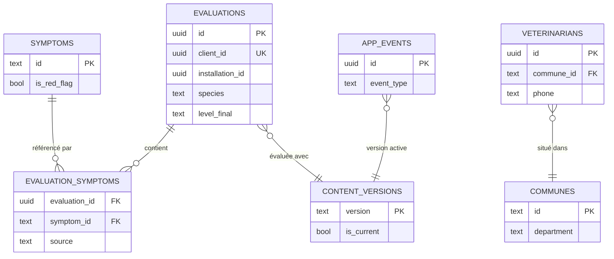

# Sanimo — Schéma backend

| | |
|---|---|
| Version | 0.2 (brouillon) : priorités 48 h, tables de retours terrain |
| Date | 31 octobre 2026 |
| Basé sur | [PRD v0.2](01-PRD.md) · [TRD v0.1](02-TRD.md) · [App flow v0.1](03-App-flow.md) |
| Plateforme | Supabase (Postgres, connexion anonyme, Row Level Security, Edge Functions) |

> **Document de conception.** Le règlement interdit le code avant l'événement : les tables sont décrites ici sous forme de tableaux. Le SQL, les migrations et les politiques seront écrits le 27 novembre à partir de ce document.

---

## 1. Principes

1. **Le téléphone est la source de vérité.** Le backend n'est pas nécessaire au parcours ; il reçoit des copies anonymes et fournit des mises à jour.
2. **Minimisation.** Aucune donnée qui identifie une personne : pas de nom, de téléphone, de position, d'audio, de photo, ni de texte libre.
3. **Écriture seule pour l'application.** Les utilisateurs anonymes peuvent insérer leurs évaluations, jamais les lire.
4. **Idempotence.** Chaque élément envoyé porte un identifiant généré sur le téléphone ; un renvoi ne crée pas de doublon.
5. **Simple.** Peu de tables, pas de logique serveur obligatoire pour le MVP.

---

## 2. Vue d'ensemble

| Table | Rôle | Écrit par | Lu par |
|---|---|---|---|
| `evaluations` | Une évaluation anonyme | Application (anonyme) | Équipe (tableau de bord) |
| `evaluation_symptoms` | Symptômes d'une évaluation, avec leur origine | Application (anonyme) | Équipe |
| `app_events` | Événements d'usage (installation, pack IA, voix…) | Application (anonyme) | Équipe |
| `symptoms` | Référentiel des symptômes (miroir du contenu) | Équipe | Équipe, application |
| `content_versions` | Versions publiées du contenu | Équipe | Application |
| `communes` | Référentiel départements / communes | Équipe | Application |
| `veterinarians` | Annuaire | Équipe | Application |
| `vet_feedback` | Avis d'un vétérinaire sur une orientation (après le hackathon) | Vétérinaire partenaire | Équipe |
| `owner_followups` | Suivi du propriétaire : a-t-il consulté ? (après le hackathon) | Application (anonyme) | Équipe |

### 2.1 Priorités pour 48 h

Avec 3 développeurs et 48 h, le backend n'est pas sur le chemin critique de la démo. On construit seulement ce qui est utile :

| Priorité | Tables | Pourquoi |
|---|---|---|
| **P0** | `evaluations`, `evaluation_symptoms` | Montrer la synchronisation des évaluations hors ligne pendant la démo |
| **P1** | `veterinarians` (avec `department` et `commune` en texte), `content_versions` | Mise à jour de l'annuaire et du contenu |
| **P2** | `app_events`, `symptoms`, `communes` | Analyse d'usage et tableau de bord lisible ; le contenu JSON de l'application suffit pour la démo |
| **Après le hackathon** | `vet_feedback`, `owner_followups` | Mesurer l'impact pendant les tests de terrain |

**Simplifications MVP :**
- Sans la table `symptoms`, `evaluation_symptoms.symptom_id` est un texte libre contrôlé côté application (pas de clé étrangère).
- Sans la table `communes`, `veterinarians` porte directement `department` et `commune` en texte ; le repli vers les communes voisines se fait avec une liste dans le contenu de l'application.
- Sans `content_versions`, `evaluations.content_version` est un simple texte.

---

## 3. Types énumérés

| Type | Valeurs |
|---|---|
| `species` | `dog`, `cat` |
| `age_group` | `young`, `adult`, `senior`, `unknown` |
| `sex` | `male`, `female`, `unknown` |
| `triage_level` | `red`, `orange`, `green` |
| `locale` | `ht`, `fr` |
| `input_mode` | `voice`, `text` |
| `symptom_source` | `model` (détecté par le modèle), `lexicon` (détecté par le lexique), `user` (ajouté par l'utilisateur), `question` (réponse « oui » à une question) |
| `nlu_engine` | `embeddings`, `lexicon_only`, `online_llm` |
| `event_type` | `app_installed`, `ai_pack_download_started`, `ai_pack_ready`, `ai_pack_failed`, `evaluation_started`, `evaluation_abandoned`, `vet_call_clicked`, `vet_whatsapp_clicked`, `sheet_shared`, `rabies_opened`, `emergency_opened` |

---

## 4. Tables

Conventions : clés primaires `uuid` générées côté serveur (`id`) ; dates en `timestamptz` UTC ; noms en anglais, `snake_case`.

### 4.1 `evaluations`

| Colonne | Type | Contraintes | Description |
|---|---|---|---|
| `id` | uuid | PK, défaut généré | Identifiant serveur |
| `client_id` | uuid | **unique**, non nul | Identifiant généré sur le téléphone (idempotence) |
| `installation_id` | uuid | non nul | `auth.uid()` de la connexion anonyme |
| `created_hour` | timestamptz | non nul | Date de l'évaluation **tronquée à l'heure** |
| `received_at` | timestamptz | défaut `now()` | Réception par le serveur |
| `species` | species | non nul | |
| `age_group` | age_group | non nul | |
| `sex` | sex | non nul | |
| `locale` | locale | non nul | Langue de l'interface |
| `input_mode` | input_mode | non nul | Voix ou clavier |
| `nlu_engine` | nlu_engine | non nul | Moteur de compréhension utilisé |
| `was_offline` | boolean | non nul | Évaluation faite hors ligne |
| `level_rules` | triage_level | non nul | Niveau calculé par les règles |
| `level_model` | triage_level | nullable | Niveau proposé par le modèle (absent si lexique seul) |
| `level_final` | triage_level | non nul | Niveau affiché |
| `triggered_rule_ids` | text[] | non nul, défaut vide | Identifiants des règles déclenchées |
| `unknown_answers` | smallint | ≥ 0 | Nombre de « je ne sais pas » |
| `bite_reported` | boolean | non nul | Réponse « oui » à la question morsure |
| `photos_count` | smallint | 0 à 3 | Nombre de photos jointes (les photos ne sont pas envoyées) |
| `duration_seconds` | integer | ≥ 0 | Durée du parcours |
| `content_version` | text | FK → `content_versions.version` | Version du contenu et des règles |
| `app_version` | text | non nul | Version de l'application |

**Contraintes de cohérence :**
- `level_final` ≥ `level_rules` (ordre : green < orange < red), ce qui vérifie côté serveur que le modèle n'a jamais abaissé le niveau ;
- si `nlu_engine = lexicon_only`, alors `level_model` est nul.

**Index :** `created_hour`, `level_final`, `species`, `content_version`.

### 4.2 `evaluation_symptoms`

| Colonne | Type | Contraintes | Description |
|---|---|---|---|
| `evaluation_id` | uuid | FK → `evaluations.id`, suppression en cascade | |
| `symptom_id` | text | FK → `symptoms.id` | |
| `source` | symptom_source | non nul | Origine de la détection |
| `confirmed` | boolean | non nul | Gardé (true) ou retiré (false) par l'utilisateur sur E24 |
| `score` | real | nullable, 0 à 1 | Score de similarité du modèle |

**Clé primaire :** (`evaluation_id`, `symptom_id`, `source`).

Les lignes avec `confirmed = false` mesurent les erreurs du modèle : un symptôme proposé puis retiré par l'utilisateur.

### 4.3 `app_events`

| Colonne | Type | Contraintes | Description |
|---|---|---|---|
| `id` | uuid | PK | |
| `client_id` | uuid | unique | Idempotence |
| `installation_id` | uuid | non nul | `auth.uid()` |
| `event_type` | event_type | non nul | |
| `created_hour` | timestamptz | non nul | Tronquée à l'heure |
| `app_version` | text | non nul | |
| `content_version` | text | nullable | |
| `props` | jsonb | défaut `{}`, taille limitée | Propriétés non identifiantes (ex. `{"pack_mb": 180, "duration_s": 340}`) |

**Liste blanche des clés de `props`** (vérifiée côté serveur) : `pack_mb`, `duration_s`, `error_code`, `level`, `department`, `webgpu`, `device_memory_gb`.

### 4.4 `symptoms`

| Colonne | Type | Contraintes | Description |
|---|---|---|---|
| `id` | text | PK | Ex. `urinary_straining`, `breathing_difficulty` |
| `category` | text | non nul | `respiratory`, `urinary`, `digestive`, `neuro`, `trauma`, `toxic`, `general`… |
| `species` | species[] | non nul | Espèces concernées |
| `is_red_flag` | boolean | non nul | Signe d'alerte |
| `label_fr` | text | non nul | |
| `label_ht` | text | non nul | |
| `source_ref` | text | non nul | Ex. `merck-emergencies`, `cornell-ecc` |
| `introduced_in` | text | FK → `content_versions.version` | |

Le fichier `content/symptomes.json` de l'application est la référence ; cette table en est une copie, chargée au déploiement, pour rendre le tableau de bord lisible.

### 4.5 `content_versions`

| Colonne | Type | Contraintes | Description |
|---|---|---|---|
| `version` | text | PK | Ex. `2026.11.27-1` |
| `published_at` | timestamptz | non nul | |
| `is_current` | boolean | non nul | **Une seule** ligne à true (index unique partiel) |
| `manifest_url` | text | non nul | URL du manifeste de contenu sur l'hébergement statique |
| `min_app_version` | text | non nul | Version minimale de l'application compatible |
| `notes` | text | nullable | Changements (ex. « règle chat mâle ajustée ») |
| `reviewed_by_vet` | boolean | non nul, défaut false | Contenu relu par un vétérinaire |

Les fichiers de contenu (JSON, clips audio, embeddings) restent sur l'**hébergement statique**. Supabase indique seulement quelle version est en vigueur.

### 4.6 `communes`

| Colonne | Type | Contraintes | Description |
|---|---|---|---|
| `id` | text | PK | Ex. `ouest-petion-ville` |
| `department` | text | non nul | Un des 10 départements |
| `name` | text | non nul | |
| `neighbors` | text[] | défaut vide | Communes voisines (repli quand l'annuaire est vide, voir App flow §8) |

### 4.7 `veterinarians`

| Colonne | Type | Contraintes | Description |
|---|---|---|---|
| `id` | uuid | PK | |
| `name` | text | non nul | Nom de la clinique ou du cabinet |
| `kind` | text | `clinic`, `practice`, `public_service`, `ngo` | |
| `commune_id` | text | FK → `communes.id` | |
| `address` | text | nullable | |
| `phones` | text[] | au moins 1 | Format international `+509…` |
| `whatsapp` | text | nullable | Format international |
| `hours` | text | nullable | Texte libre court |
| `emergency_24h` | text | `yes`, `no`, `unknown` | |
| `species` | species[] | défaut `{dog,cat}` | |
| `verified_at` | date | non nul | Dernière vérification par l'équipe |
| `source` | text | non nul | Ex. « appel téléphonique », « recommandation d'un vétérinaire » |
| `consent` | boolean | non nul | Accord de la clinique pour figurer dans l'annuaire |
| `active` | boolean | défaut true | Masquer sans supprimer |
| `updated_at` | timestamptz | défaut `now()` | Sert à la mise à jour incrémentale |

Seules les lignes `active = true` et `consent = true` sont visibles par l'application.

### 4.8 `vet_feedback` (après le hackathon)

Sert à mesurer l'**accord entre l'orientation de Sanimo et l'avis d'un vétérinaire** (indicateur du PRD §5.3). Le propriétaire montre la fiche ; le vétérinaire scanne un code QR affiché sur la fiche (E60) et répond à 3 questions sur un formulaire web.

| Colonne | Type | Contraintes | Description |
|---|---|---|---|
| `id` | uuid | PK | |
| `evaluation_client_id` | uuid | non nul | Identifiant de l'évaluation, contenu dans le code QR |
| `vet_code` | text | non nul | Code fourni à chaque vétérinaire partenaire (pas de nom) |
| `vet_level` | triage_level | non nul | Niveau que le vétérinaire aurait donné |
| `sheet_useful` | smallint | 1 à 5 | Utilité de la fiche |
| `comment` | text | nullable, 500 caractères max | Remarque du vétérinaire, sans donnée sur le propriétaire |
| `created_at` | timestamptz | défaut `now()` | |

- Pas de clé étrangère vers `evaluations` : l'évaluation n'a peut-être pas encore été synchronisée.
- Accès : insertion via une Edge Function qui vérifie `vet_code` ; aucune lecture publique.

### 4.9 `owner_followups` (après le hackathon)

Sert à savoir si les propriétaires orientés vers 🔴 ou 🟠 **ont réellement consulté**. 48 h après une évaluation, l'application pose une question à l'ouverture suivante : « Èske w te ale kay veterinè a ? » (Êtes-vous allé chez le vétérinaire ?).

| Colonne | Type | Contraintes | Description |
|---|---|---|---|
| `id` | uuid | PK | |
| `client_id` | uuid | unique | Idempotence |
| `installation_id` | uuid | non nul | `auth.uid()` |
| `evaluation_client_id` | uuid | non nul | Évaluation concernée |
| `consulted` | text | `yes`, `no`, `planned` | |
| `reason_not` | text | nullable : `cost`, `distance`, `improved`, `no_vet`, `other` | Pourquoi pas de consultation |
| `animal_status` | text | nullable : `better`, `same`, `worse`, `died` | Évolution déclarée |
| `created_hour` | timestamptz | non nul | Tronquée à l'heure |

- Accès : insertion seule, comme `evaluations`.
- Réponse facultative, une seule fois par évaluation.

---

## 5. Sécurité (Row Level Security)

RLS **activée sur toutes les tables**.

| Table | Rôle `anon` / utilisateur anonyme connecté | Rôle équipe |
|---|---|---|
| `evaluations` | **INSERT** seulement, si `installation_id = auth.uid()` | Lecture complète |
| `evaluation_symptoms` | **INSERT** seulement, si l'évaluation parente appartient à `auth.uid()` | Lecture complète |
| `app_events` | **INSERT** seulement, si `installation_id = auth.uid()` | Lecture complète |
| `symptoms` | SELECT | Toutes opérations |
| `content_versions` | SELECT | Toutes opérations |
| `communes` | SELECT | Toutes opérations |
| `veterinarians` | SELECT, si `active` et `consent` | Toutes opérations |
| `vet_feedback` | Aucun accès direct (insertion via Edge Function) | Lecture complète |
| `owner_followups` | **INSERT** seulement, si `installation_id = auth.uid()` | Lecture complète |

**Accès « équipe » :** comptes nominatifs des 3 développeurs via le tableau de bord Supabase ; la clé `service_role` n'est **jamais** dans l'application ni dans le dépôt.

**Limitation d'abus :**
- taille maximale d'un lot : 50 évaluations ;
- contraintes de valeurs (énumérés, bornes) au niveau de la base ;
- `props` limité à la liste blanche ;
- volume par installation surveillé dans le tableau de bord (pas de blocage pour le MVP).

**Connexion anonyme :** créée au premier envoi (pas à l'ouverture), pour ne rien créer si l'utilisateur ne revient jamais en ligne. Elle doit être activée dans les réglages du projet.

---

## 6. Contrats d'échange

### 6.1 Envoi des évaluations
- Méthode : insertion via l'API REST de Supabase (client `supabase-js`), en mode « ignorer les doublons » sur `client_id`.
- Ordre : `evaluations` puis `evaluation_symptoms`. Si la seconde échoue, l'élément reste dans la file et l'envoi complet est rejoué ; les doublons sont ignorés.
- Option P1 : une fonction Postgres `submit_evaluations(payload jsonb)` qui insère les deux tables en une transaction. Plus robuste, à décider le jour J.

**Format d'un élément de la file d'envoi (côté téléphone) :**

| Champ | Exemple |
|---|---|
| `client_id` | `"7c1e…"` |
| `created_hour` | `"2026-11-28T14:00:00Z"` |
| `species` | `"cat"` |
| `age_group` | `"adult"` |
| `sex` | `"male"` |
| `locale` | `"ht"` |
| `input_mode` | `"voice"` |
| `nlu_engine` | `"embeddings"` |
| `was_offline` | `true` |
| `level_rules` / `level_model` / `level_final` | `"red"` / `"orange"` / `"red"` |
| `triggered_rule_ids` | `["cat_male_urinary_obstruction"]` |
| `unknown_answers` | `0` |
| `bite_reported` | `false` |
| `photos_count` | `1` |
| `duration_seconds` | `74` |
| `content_version` / `app_version` | `"2026.11.27-1"` / `"0.1.0"` |
| `symptoms` | `[{"symptom_id": "urinary_straining", "source": "model", "confirmed": true, "score": 0.83}]` |

### 6.2 Vérification du contenu
1. L'application lit la ligne `content_versions` où `is_current = true`.
2. Si la version diffère de la version locale et que `min_app_version` est compatible, elle télécharge le manifeste depuis `manifest_url`.
3. Le manifeste liste les fichiers et leurs empreintes ; seuls les fichiers modifiés sont téléchargés.
4. Activation au prochain lancement.

### 6.3 Annuaire
- Requête des vétérinaires avec `updated_at` postérieur à la dernière synchronisation locale.
- Fusion dans IndexedDB ; les lignes devenues inactives sont retirées localement.

### 6.4 Edge Function (P2) : `extract-symptoms`
| Point | Détail |
|---|---|
| Entrée | Texte de la description, langue, espèce |
| Traitement | Appel d'un modèle de langue avec la liste fermée des symptômes ; réponse structurée |
| Sortie | Liste `{symptom_id, confidence}` ; jamais de diagnostic |
| Stockage | **Aucun** : le texte n'est ni enregistré ni journalisé |
| Secret | Clé API dans les secrets de la fonction |
| Limites | Taille du texte bornée ; délai court ; repli local en cas d'échec |

> Cette fonction envoie le texte libre à un service tiers. Il faut l'indiquer à l'utilisateur et la rendre désactivable dans E90.

---

## 7. Stockage local (IndexedDB)

Le téléphone détient l'essentiel des données. Base `sanimo`, gérée par Dexie.

| Magasin | Clé | Contenu | Quitte le téléphone ? |
|---|---|---|---|
| `evaluations` | `client_id` | Évaluation complète : description d'origine, transcription, symptômes, réponses, niveaux, consignes affichées | Version anonyme seulement (§6.1) |
| `photos` | `id` | Blob JPEG compressé, `evaluation_client_id`, date | **Jamais** |
| `outbox` | `client_id` | Éléments à envoyer (évaluations, événements), nombre d'essais, dernière erreur | Oui, puis supprimé |
| `vets` | `id` | Copie de l'annuaire | — |
| `settings` | clé | Langue, lecture automatique, dernière commune, avertissement accepté, `installation_id`, envoi en ligne autorisé | Non |
| `content_meta` | clé | Version du contenu, empreintes | Non |
| `ai_pack` | composant | État (absent, en cours, prêt), octets reçus, empreinte | Non |
| `drafts` | `client_id` | Évaluation en cours (reprise après interruption) | Non |

Les fichiers de modèles sont dans le **Cache Storage** (géré par transformers.js et le service worker), pas dans IndexedDB.

**Effacer mes données (E90) :** vide tous les magasins et les caches, puis se déconnecte de la session anonyme. Les données déjà envoyées restent anonymes côté serveur.

---

## 8. Tableau de bord (démo et suivi)

Vues SQL **réservées à l'équipe**, non exposées au rôle `anon` :

| Vue | Contenu |
|---|---|
| `v_evaluations_by_level` | Nombre d'évaluations par jour et par niveau |
| `v_top_symptoms` | Symptômes confirmés les plus fréquents, par espèce |
| `v_model_corrections` | Symptômes proposés par le modèle puis retirés (`confirmed = false`), par symptôme |
| `v_rules_vs_model` | Cas où le modèle a relevé le niveau, ou a proposé plus bas que les règles |
| `v_voice_usage` | Part voix / clavier, part hors ligne |
| `v_funnel` | Démarrées → terminées → appel au vétérinaire |

Pour la démo : une page simple, ou l'éditeur SQL de Supabase, montre que les évaluations faites hors ligne arrivent au retour du réseau.

---

## 9. Volumes et offre gratuite

| Élément | Estimation hackathon et tests | Limite gratuite Supabase |
|---|---|---|
| Évaluations | Quelques milliers de lignes (< 5 Mo) | 500 Mo de base |
| Événements | Quelques dizaines de milliers de lignes (< 20 Mo) | |
| Utilisateurs anonymes | Quelques centaines | 50 000 actifs / mois |
| Trafic | Très faible (pas de fichiers servis par Supabase) | 5 Go / mois |

**À ne pas oublier :** un projet gratuit se met en pause après **7 jours d'inactivité**. Le réveiller la veille de la démo et vérifier un envoi.

---

## 10. Confidentialité et conservation

- Données envoyées : anonymes, structurées, sans texte libre ; dates tronquées à l'heure.
- Pas de stockage d'adresse IP dans les tables. Les journaux de la plateforme Supabase peuvent en contenir ; à mentionner dans la page « À propos ».
- Conservation proposée : évaluations et événements gardés 12 mois, puis agrégés et supprimés.
- Région du projet : la plus proche d'Haïti disponible (ex. côte est des États-Unis) **[à vérifier]**.

---

## 11. Mise en place le jour J (checklist)

**P0 (vendredi soir au plus tard) :**
1. Créer le projet Supabase ; activer la **connexion anonyme**.
2. Créer les types énumérés, puis `evaluations` et `evaluation_symptoms` (version simplifiée, §2.1).
3. Activer RLS et écrire les politiques d'insertion seule (§5).
4. Tester avec la clé `anon` : insertion OK, lecture refusée, doublon ignoré.
5. Une vue `v_evaluations_by_level` pour la démo.

**P1 (samedi) :**
6. `veterinarians` (avec `department` et `commune` en texte) et `content_versions` ; charger l'annuaire et la première version.

**P2 (si le temps le permet) :**
7. `app_events`, `symptoms`, `communes` ; vues complètes du tableau de bord (§8).
8. Fonction `extract-symptoms`.

**Après le hackathon :** `vet_feedback` (avec code QR sur la fiche et formulaire vétérinaire) et `owner_followups` (question de suivi à 48 h).

---

## 12. Points ouverts

1. Faut-il passer par la fonction transactionnelle `submit_evaluations` dès le MVP ?
2. Faut-il enregistrer le département choisi dans l'annuaire (`props.department`) ? C'est utile pour savoir où sont les besoins, mais c'est une information de localisation grossière.
3. Qui vérifie et met à jour l'annuaire après le hackathon ?
4. Faut-il garder l'option en ligne (`extract-symptoms`), vu qu'elle envoie du texte libre à un tiers ?
